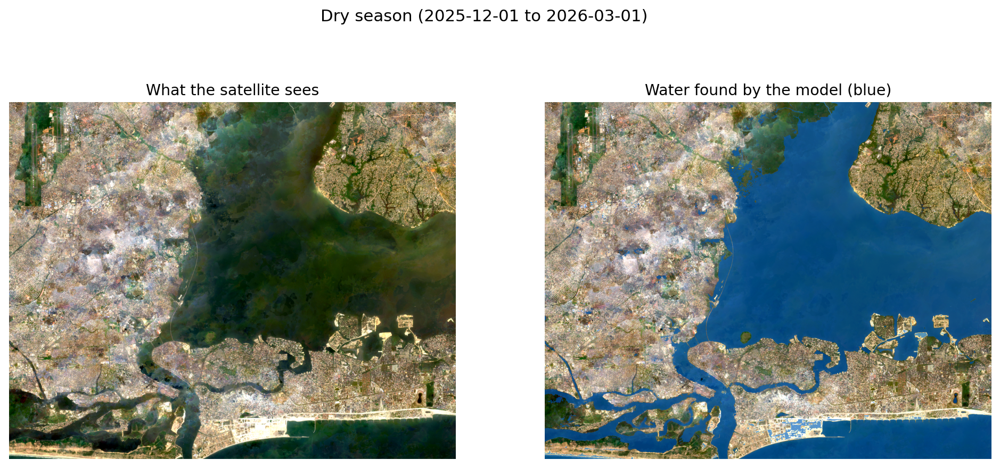
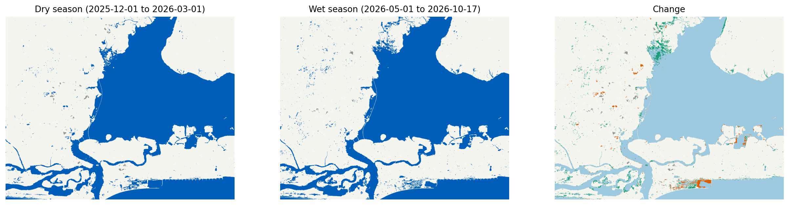

# Water body detection from Sentinel-2 (NDWI / MNDWI + Decision Tree)

Maps surface water (lagoon, creeks, rivers, reservoirs, ponds) from Sentinel-2 imagery with a Decision Tree,
and measures how good the map is. The accuracy check does not stop at the training labels: it also scores the
model against points you label yourself from high-resolution imagery.


## Results

# waterdet results

## Label mode `gsw` (training period `dry`)

- Tree: depth 2, 4 leaves, params {'max_depth': 2, 'min_samples_leaf': 50}
- Points: 6954 train / 3046 test (116 / 52 spatial blocks)
- Train overall accuracy: 0.9810 (shown only to expose over-fitting)

| Method (spatial hold-out) | Overall acc. [95% CI] | Kappa [95% CI] | Water F1 | Water IoU |
| --- | --- | --- | --- | --- |
| **Decision Tree** | 0.9852 [0.969, 0.995] | 0.9704 [0.936, 0.990] | 0.9855 | 0.9714 |
| NDWI>0 (thr 0.000) | 0.9734 | 0.9468 | 0.9742 | 0.9496 |
| MNDWI>0 (thr 0.000) | 0.9839 | 0.9678 | 0.9842 | 0.9689 |
| NDWI Otsu (thr 0.012) | 0.9770 | 0.9540 | 0.9776 | 0.9561 |
| MNDWI Otsu (thr 0.066) | 0.9879 | 0.9757 | 0.9880 | 0.9763 |

_These scores measure agreement with JRC-derived labels on held-out spatial blocks, using a class-balanced 50:50 sample. They are NOT independent truth, and water precision / F1 / IoU change with the class ratio. Use the area-weighted reference validation below for headline numbers._

## Label mode `gsw_dw` (training period `dry`)

- Tree: depth 2, 3 leaves, params {'max_depth': 2, 'min_samples_leaf': 1}
- Points: 6974 train / 3026 test (121 / 46 spatial blocks)
- Train overall accuracy: 0.9996 (shown only to expose over-fitting)

| Method (spatial hold-out) | Overall acc. [95% CI] | Kappa [95% CI] | Water F1 | Water IoU |
| --- | --- | --- | --- | --- |
| **Decision Tree** | 0.9960 [0.992, 0.999] | 0.9921 [0.984, 0.998] | 0.9960 | 0.9921 |
| NDWI>0 (thr 0.000) | 0.9815 | 0.9630 | 0.9817 | 0.9640 |
| MNDWI>0 (thr 0.000) | 0.9937 | 0.9874 | 0.9937 | 0.9875 |
| NDWI Otsu (thr 0.012) | 0.9874 | 0.9749 | 0.9875 | 0.9753 |
| MNDWI Otsu (thr 0.066) | 0.9967 | 0.9934 | 0.9967 | 0.9934 |

_These scores measure agreement with JRC-derived labels on held-out spatial blocks, using a class-balanced 50:50 sample. They are NOT independent truth, and water precision / F1 / IoU change with the class ratio. Use the area-weighted reference validation below for headline numbers._

## Water extent (primary model)

| Period | Water km² | Land km² | No data % |
| --- | --- | --- | --- |
| dry | 230.10 | 381.56 | 0.2 |
| wet | 236.88 | 375.34 | 0.1 |

### Change dry_to_wet

- stable land: 370.64 km²
- stable water: 226.27 km²
- water gain (land -> water): 10.56 km²
- water loss (water -> land): 3.80 km²
- compared_km2: 611.27 km²

## Notes and warnings

- No independent reference points found at data/reference_points.csv. Accuracy above is agreement with JRC-derived labels only. Optional: docs/OPTIONAL_ACCURACY_CHECK.md explains how to get a true accuracy figure.

## Provenance

- Python 3.13.16; packages: waterdet 0.1.0, numpy 2.1.3, scipy 1.16.3, pandas 2.2.3, scikit-learn 1.6.1, rasterio 1.5.2, earthengine-api 1.7.39
- Input `s2_dry.tif` sha256 `1779b694527fe1f9…`
- Input `s2_wet.tif` sha256 `eeef3e335953aa7d…`
- Full config snapshot (GEE project id redacted) is in `summary.json`.

   
   
   


## How it works

```
Google Earth Engine (server side)                     This repo (your session / laptop)
─────────────────────────────────                     ──────────────────────────────────────────────
Sentinel-2 L2A  ──┐                                    labels.py    GSW (+ Dynamic World) -> water / land / ignore
Cloud Score+ mask ├─> seasonal median composite ──┐    sampling.py  balanced points, spatial blocks, block split
JRC GSW labels   ─┤                               ├──> model.py     Decision Tree, spatial CV, 1-SE rule
Dynamic World    ─┘   export GeoTIFF to Drive ────┘    evaluate.py  hold-out, baselines, bootstrap CIs
                                                       reference.py your independent points, area-weighted accuracy
                                                       predict.py / change.py   water map per season + change map
```

Choices that differ from a basic NDWI tutorial (reasons in [docs/METHODOLOGY.md](docs/METHODOLOGY.md)):

- **Cloud Score+** masking instead of QA60, with a seasonal median composite.
- **Labels from JRC Global Surface Water**, keeping only confident pixels away from shorelines. A second label mode
  also requires Dynamic World to agree, to catch land reclaimed after GSW's 2021 end date.
- **Spatial block split** for train/test and for cross-validation. A random pixel split leaks near-identical
  neighbours into the test set and inflates accuracy.
- **Tree depth tuned** with spatial CV and the one-standard-error rule, then compared with NDWI>0, MNDWI>0 and Otsu
  thresholds so you can see what the learned model adds.
- **Optional independent validation**: ~220 reference points drawn from the map, labelled blind by you, scored with
  area weights (Olofsson et al. 2014) and bootstrap confidence intervals.

## Repository layout

| Path | What it is |
|---|---|
| `config.yaml` | Every setting. Already chosen; the notebook fills in your project ID. |
| `notebooks/waterdet_colab.ipynb` | Guided run: Earth Engine export, pipeline, figures. Start here. |
| `src/waterdet/` | The package (see diagram above, plus `gee_export.py`, `io.py`, `indices.py`, `plots.py`). |
| `tests/` | 50 tests on a synthetic study area with known truth. No Earth Engine needed. |
| `app/` | Streamlit app (map explorer, seasonal change, model rules). See `app/README.md`. |
| `docs/HOW_TO_RUN.md` | Plain steps to run it. `OPTIONAL_ACCURACY_CHECK.md` covers the optional true-accuracy step. |
| `docs/METHODOLOGY.md` | Method, deviations from the proposal, limitations. |
| `data/` | Exported GeoTIFFs and your reference points. Rasters are git-ignored. |
| `outputs/` | Maps, figures, metrics. Git-ignored except `.gitkeep`. |

## Quick start

**Run it in Colab (recommended, nothing to install).** Follow [docs/HOW_TO_RUN.md](docs/HOW_TO_RUN.md): upload
`notebooks/waterdet_colab.ipynb` to <https://colab.research.google.com>, type your Earth Engine project ID in the one
box, click **Runtime > Run all**, and approve the two Google pop-ups. The notebook carries its own copy of the code.

**Run it locally (Windows / VS Code, optional).**

```powershell
python -m venv .venv
.venv\Scripts\activate
pip install -e ".[gee,dev]"
# set gee.project in config.yaml, then:
python -m waterdet.gee_export export --config config.yaml   # starts Drive exports
# when they finish, download s2_dry.tif and s2_wet.tif from the Drive folder into data\
python -m waterdet.pipeline --config config.yaml --data-dir data --out-dir outputs
python -m pytest                                              # optional: run the test-suite
```


## Outputs

| File | Meaning |
|---|---|
| `outputs/summary.md`, `summary.json` | All metrics, notes and warnings, provenance (package versions, input hashes). |
| `outputs/maps/water_<season>.tif` | 0 = land, 1 = water, 255 = no data (too few clear observations). 10 m, UTM. |
| `outputs/maps/change_dry_to_wet.tif` | 0 stable land, 1 stable water, 2 gain, 3 loss, 255 no data. |
| `outputs/mode_<label mode>/` | Model, readable tree rules, CV table, confusion matrix, tree and importance figures. |
| `outputs/reference_frame/` | CSV and KML of the points to label, plus the strata weights. |


## Data and references

Sentinel-2 L2A (Copernicus / ESA); Cloud Score+ (Google); JRC Global Surface Water v1.4 (Pekel et al. 2016,
*Nature* 540:418-422); Dynamic World (Brown et al. 2022, *Scientific Data* 9:251); NDWI (McFeeters 1996,
*Int. J. Remote Sens.* 17:1425-1432); MNDWI (Xu 2006, *Int. J. Remote Sens.* 27:3025-3033); accuracy assessment
(Olofsson et al. 2014, *Remote Sens. Environ.* 148:42-57).

## Licence

MIT. See `LICENSE`.
